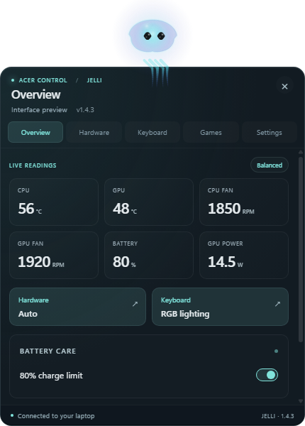
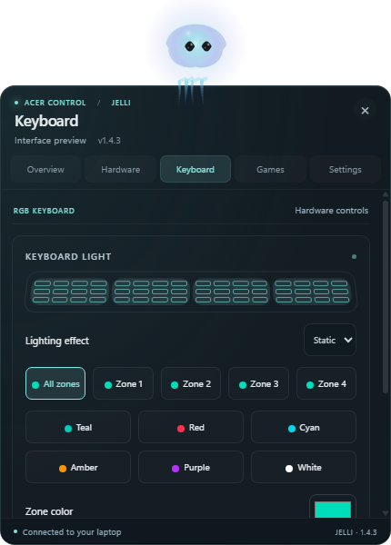
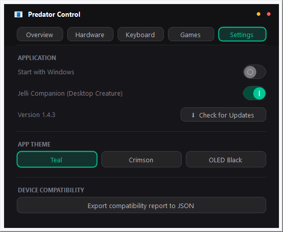

# 🪼 Predator Control

**A control panel and desktop companion for compatible Acer Predator and Nitro laptops.**

[Download 1.4.4](https://github.com/Hadisovic/PredatorControl/releases/tag/v1.4.4) · [Source](https://github.com/Hadisovic/PredatorControl/tree/revisions) · [Report a problem](https://github.com/Hadisovic/PredatorControl/issues)

Windows 10 (2004 or later) / Windows 11 · x64 · Administrator approval required

## What's new in 1.4.4

- **RGB Keyboard Enhancements**: Dynamic multi-zone RGB keyboard detection (4 zones across all supported Predator & Nitro RGB models) and clean Fixed-Red single-color backlight handling on older Nitro models without hardcoded model lists.
- **Hardware GPU MUX Switch**: Added direct ACPI WMI MUX switching when OEM services are absent. Fixed MUX control disappearing when booted in Discrete GPU Only mode (where the iGPU is powered down by hardware).
- **Dynamic Hardware Compatibility**: Enhanced support across 64+ Acer Predator and Nitro models with dynamic protocol discovery.
- **Power & Performance Switching**: Reliable direct WMI and ACPI operation mode switching (Quiet, Balanced, Performance, Turbo, Eco) with confirmed firmware state readback.
- **Fan Curve Editor & Limits**: Visual limit guideline and shaded deadzone enforcing hardware minimum fan floor (10% floor) on supported channels.
- **Display & Overdrive**: 3ms LCD Overdrive support and refresh rate controls on high-refresh panels.
- **Restored OSD Descriptors**: Rich performance mode descriptors in the gaming on-screen display overlay.
- **Installer & Portable Optimizations**: Single portable EXE and clean offline setup installer without external runtime dependencies.

## Choose your download

| Download | Best for | What happens |
|---|---|---|
| [Installer](https://github.com/Hadisovic/PredatorControl/releases/download/v1.4.4/PredatorControl-Setup-1.4.4.exe) | Regular use on one laptop | Installs the app, adds Start Menu and desktop shortcuts and provides an uninstaller. |
| [Portable EXE](https://github.com/Hadisovic/PredatorControl/releases/download/v1.4.4/PredatorControl-Portable-1.4.4.exe) | Running without a conventional installation | Run one EXE; no shortcut or startup task is created unless you enable startup. |

Both contain the complete application and runtime. Jelli uses the Microsoft Edge WebView2 Runtime already installed on Windows. Classic remains available if WebView2 is unavailable.

### Install

1. Run **PredatorControl-Setup-1.4.4.exe**.
2. Open it and approve Windows administrator access.
3. Leave **Start Predator Control with Windows** checked, or clear it if you prefer manual launch.
4. Leave **Launch PredatorControl** checked on the finish page to open the app, or launch it later from the desktop shortcut or Start Menu.

If the destination already exists, choose **Yes** to continue with a verified repair, or **No** to cancel and remove the old installation or conflicting file first. Setup does not delete it automatically. Unsafe paths are still refused.

The app installs beneath Program Files. You can delete the downloaded setup file afterward. Remove the installed app through Windows **Settings → Apps → Installed apps**. Removal clears its startup tasks; preferences and the reusable browser cache are retained.

### Run portable

1. Keep **PredatorControl-Portable-1.4.4.exe** in a convenient local folder.
2. Open it and approve Windows administrator access.
3. Enable Jelli if the Windows WebView2 Runtime is installed. Classic remains available without it.

The portable EXE includes the app and .NET runtime. It does not bundle Chromium/WebView2; browser profile data remains per user.

If you enable **Start with Windows** in Settings, the app creates a persistent protected copy for startup. After closing the current session, you may delete the original downloaded EXE. Turning startup off removes the startup tasks and retains the installed copy.

## Current interface previews

These images show the current 1.4.3 interface. **Jelli uses simulated preview readings; Classic was captured on an unsupported virtual machine.** Available controls on your laptop may differ.

## Two interfaces

Choose the **Classic control panel** for a conventional Windows dashboard or **Jelli** for a floating jellyfish companion with an expandable dashboard and attached flyout. Both use the same supported hardware features.

Switch interfaces in Settings. Theme choices include Teal, Crimson and OLED Black.

## Core capabilities

Features below are available only where the laptop and its interfaces support them.

| Area | Controls |
|---|---|
| **Performance** | Available Quiet, Balanced/Default, Performance, Turbo or Eco profiles; AC/battery preferences; supported hardware-key actions. |
| **Cooling** | Firmware Auto, Max and supported custom fan controls, fan curves and CoolBoost. |
| **Keyboard** | Supported single-color backlight controls, idle timeout, RGB effects, zone colors and saved lighting profiles. |
| **Display and GPU** | Available GPU/MUX modes, internal/external refresh rates and LCD overdrive. Firmware changes may require a restart. |
| **Battery** | Supported charge limiting, health/capacity/cycle information and Windows battery reports. |
| **System** | Supported startup sound/animation, power-off USB charging and key-lock options. |
| **Games** | Game Sync profiles and a configurable gaming HUD. |
| **OEM services** | Service optimization and repair options where the required Acer components are present. |

A fixed-color keyboard does not become an RGB keyboard. Unavailable readings and unsupported controls are shown accordingly; generic Predator/Nitro branding does not guarantee a particular feature.

## Gaming overlay

Choose **Light**, **Default**, **Full** or **Complete** layouts. Available readings can include FPS, temperatures, fan speeds, power, utilization and memory usage. Metric availability varies by system and game.

| Shortcut / gesture | Action |
|---|---|
| **Ctrl + Shift + O** | Toggle the gaming overlay. |
| **Ctrl + Shift + Click** | Cycle the overlay layout. |
| **Ctrl + Shift + Drag** | Move the overlay. |
| **Ctrl + Shift + Scroll** | Adjust overlay scale. |
| **Ctrl + Shift + Middle Click** | Reset scale to 100%. |

The overlay uses Windows tracing and available GPU telemetry rather than injecting a DLL into the game. Compatibility with individual games and anti-cheat configurations is not guaranteed.

## Updating from an earlier build

Close the old app, then run the new installer or portable EXE. This packaging replaces the earlier standalone and win-x64 download choices.

For an older portable startup installation, use the new app to turn **Start with Windows** off and on again so future launches use the new copy. Setup refreshes startup registration when its startup option is selected.

This release reports version **1.4.4**.

> [!TIP]
> **Jelli troubleshooting after an update**: If Jelli does not work or displays an error after updating from an earlier version, open `C:\Program Files` and delete the `PredatorControlData` folder to allow a clean initialization, then re-launch the application.

## Troubleshooting

### Frequently Asked Questions & Solutions

* **GPU MUX Switch requires a restart**:
  * Switching between **Hybrid (Optimus)** and **Discrete GPU** mode re-routes the internal display connection at the motherboard firmware level. A full system restart is required by the BIOS and Windows graphics stack for the change to take effect.
* **GPU MUX Switch missing or says unsupported**:
  * Ensure the application is **Run as Administrator** so it has permission to query ACPI WMI and EC registers.
  * If you have PredatorSense services running, ensure `AASSvc` / `AcerAgentService` is operational. If you uninstalled PredatorSense, PredatorControl will automatically use direct ACPI WMI.
  * Note: Older laptops without a physical hardware MUX chip (or with fixed display routing) do not support MUX switching.
* **Keyboard RGB lighting only shows red or won't change color**:
  * Some laptops (notably older Nitro 5 models) have single-color fixed red backlighting in hardware rather than multi-zone RGB LEDs. On those devices, PredatorControl cleanly provides backlight on/off and brightness toggles without inventing unsupported color modes.
* **Jelli UI displays an error or blank screen after updating**:
  * Open `C:\Program Files` and delete the `PredatorControlData` folder (or your user's `%LOCALAPPDATA%\PredatorControl` folder) to clear the cached WebView2 runtime state, then restart the application.
* **Fans or power modes not applying**:
  * Certain high-performance power modes (Turbo) are restricted by Acer firmware to AC adapter power and require battery charge levels above 40%. Plug in your official charger before engaging Turbo mode.

### Report an Issue / Request Support for Your Laptop

If a feature is missing, unverified, or not working as expected on your specific Acer laptop model:

1. Open **PredatorControl** and navigate to the **Settings** tab.
2. Click **Export Compatibility Report** (or locate `PredatorControl-compatibility.json` saved in your application folder).
3. [**Open an Issue on GitHub**](https://github.com/Hadisovic/PredatorControl/issues).
4. Describe your issue and attach your `PredatorControl-compatibility.json` file.
   * *Note: PredatorControl automatically redacts all hardware serial numbers, MAC addresses, and personal identifying information before saving the report.*
   * Attaching this file lets us inspect your laptop's exact ACPI WMI method tables, sensor IDs, and power mode descriptors so we can add native support for your model!

## Compatibility and feedback

Support depends on the exact laptop model, firmware and required Acer services. Keep the Acer components needed by your laptop's controls.

When reporting a problem, include the laptop model, Windows version, app version and reproduction steps. Export a compatibility report from Settings if useful, and review its contents before sharing it.

## Building from source

Development requires the .NET 10 SDK, Node.js and Inno Setup. Run `scripts/Test-Compatibility.ps1` for the hardware-free checks. Build the setup and portable EXE with `packaging/Build.ps1 -Iscc <path-to-ISCC.exe>`. No WebView2 runtime installer is required; Jelli uses the Windows WebView2 Runtime already installed on the system.

## Credits and attribution

Special thanks to **[@supesonly](https://github.com/supesonly)** for the original inspiration and foundational concept ([supesonly/Acer-P-Helper](https://github.com/supesonly/Acer-P-Helper)).

**Made with 🪼 and neon teal**

*Acer, Predator, Nitro and PredatorSense are trademarks of Acer Inc. Predator Control is an independent project.*

