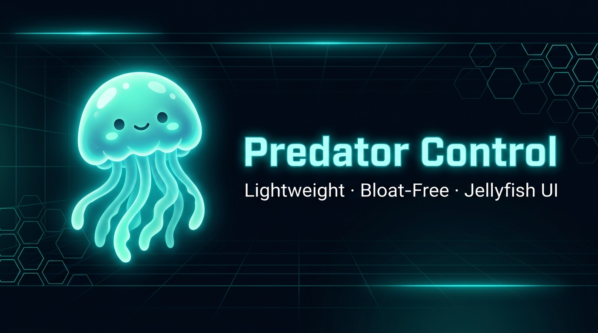
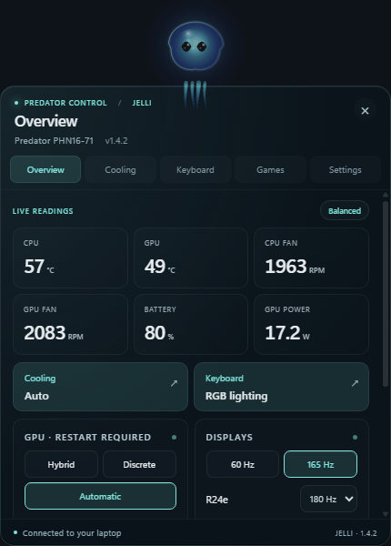
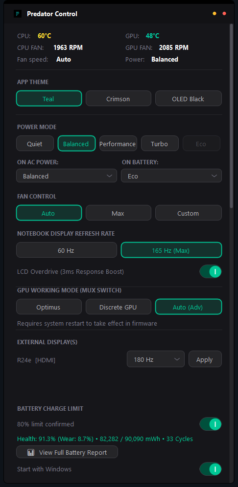
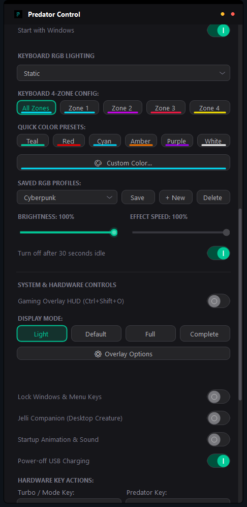

<div align="center">



# 🪼 Predator Control

[](https://github.com/Hadisovic/PredatorControl/releases)
[](#-dual-interface-classic-dashboard--jelli-companion)
[](https://github.com/Hadisovic/PredatorControl)
[](https://dotnet.microsoft.com/)

<br/>

**Predator Control** brings your supported **Acer Predator or Nitro** laptop's everyday controls into one app.  
Choose a performance mode, adjust cooling and keyboard lighting, check your battery, and see gaming stats—with either a traditional dashboard or the Jelli desktop companion.

</div>

---

### 🖼️ UI & Gaming Overlay Previews

<div align="center">
  <p>Real screenshots from Predator Control v1.4.2. Click any image to view it at full size.</p>
  <h4>🪼 Jelli — Expanded Overview</h4>
  <p><a href="assets/preview_jelli.png"></a></p>
  <h4>🖥️ Classic Control Panel</h4>
  <table>
    <tr>
      <td align="center" width="50%"><b>Dashboard, Thermals & GPU Controls</b></td>
      <td align="center" width="50%"><b>RGB Lighting & System Controls</b></td>
    </tr>
    <tr>
      <td><a href="assets/preview_dashboard.png"></a></td>
      <td><a href="assets/preview_controls.png"></a></td>
    </tr>
  </table>
  <h4>🎮 Gaming Overlay — Four Display Modes</h4>
  <table>
    <tr>
      <td align="center" width="50%"><b>Light</b></td>
      <td align="center" width="50%"><b>Default</b></td>
    </tr>
    <tr>
      <td><a href="assets/preview_overlay_light.png"></a></td>
      <td><a href="assets/preview_overlay.png"></a></td>
    </tr>
    <tr>
      <td align="center"><b>Full</b></td>
      <td align="center"><b>Complete</b></td>
    </tr>
    <tr>
      <td><a href="assets/preview_overlay_full.png"></a></td>
      <td><a href="assets/preview_overlay_complete.png"></a></td>
    </tr>
  </table>
</div>

---

## ✨ Why Predator Control?

Spend less time switching between settings and more time using your laptop.

| What you want to do | How Predator Control helps |
| :--- | :--- |
| **Keep everyday use quieter** | Choose an available quiet or balanced performance mode. |
| **Get ready for a game** | Choose a performance mode and cooling settings, or save a profile for that game. |
| **Make it your own** | Adjust supported keyboard lighting and choose Classic or Jelli. |
| **Keep an eye on your laptop** | View available temperatures, battery information, and gaming stats. |

> **Check your model:** Available features depend on your laptop, its built-in software, and its Acer drivers. Not every Predator or Nitro supports every option. Controls that cannot be confirmed may be hidden or unavailable.

---

## 🪼 Dual Interface: Classic Dashboard & Jelli Companion

Choose the interface that fits your workflow:

- **Classic Control Panel**: A traditional window that brings the available controls together in one place.
- **Jelli Desktop Companion**: A jellyfish-themed desktop companion with pages for your laptop's status, cooling, keyboard, games, and settings.
- **Switch whenever you like**: Change between Classic and Jelli in Settings. If Jelli cannot open, you can use Classic instead.

---

## 🚀 Core Capabilities

The options below appear where your laptop supports them.

### ⚡ Performance Profiles & Hotkeys

- **Choose how your laptop runs**: Select from the modes available on your model, such as Quiet, Balanced, Performance, Turbo, or Eco. Some modes need the charger plugged in.
- **Use your laptop's special keys**: Supported Mode and Predator / NitroSense keys can switch modes or open the app.
- **Different settings on battery**: Choose a preferred mode for plugged-in use and another for battery use.
- **Game Sync**: Save settings for a game and apply them when that game starts.

### 🌡️ Thermal Management & Fans

- **Auto cooling**: Let the laptop manage its fans.
- **Maximum cooling**: Run supported fans at their maximum setting.
- **Custom cooling**: Adjust supported fans separately or choose how cooling changes as the laptop gets warmer.
- **CoolBoost™**: Turn Acer's extra cooling option on or off where available.

### 🎮 Graphics & Display

- **Graphics mode**: On supported models, choose a mode that balances battery life and graphics performance. Some changes need a restart.
- **Screen refresh rate**: Choose an available screen setting for everyday use or smoother motion.
- **Display response setting**: Turn the faster-response option on or off if your screen supports it.

### 🌈 Keyboard Lighting

- **Supported RGB keyboards**: Choose colors, available effects, brightness, and saved lighting presets. Some keyboards support separate color zones.
- **Single-color keyboards**: Use the brightness and lighting options available for your keyboard.
- **Idle timeout**: Control automatic lighting sleep where supported.

### 🖥️ Battery & Other Laptop Settings

- **Battery charge limit**: Limit charging to around 80% where supported, useful if you often leave the charger connected.
- **Battery health**: View available battery condition, capacity, and charging history information, or open a Windows battery report.
- **Startup sound and animation**: Change supported startup effects.
- **USB charging while off**: Control the supported USB charging option for when your laptop is asleep or shut down.
- **Windows key lock**: Help prevent accidental Windows key presses during games.

> [!TIP]
> **Missing startup sound?** Some models need the startup sound option enabled in the laptop's BIOS settings first. Check your model's instructions if the app setting has no effect.

---

## 🎮 Gaming Overlay

See a small stats panel while you play, with available information such as frame rate, temperatures, fan speeds, and battery level.

Choose **Light**, **Default**, **Full**, or **Complete** to show less or more information. Some stats and display modes may be unavailable in certain games or on certain laptops. Compatibility with games and their anti-cheat software varies.

| Shortcut / Gesture | Action |
| :--- | :--- |
| **`Ctrl + Shift + O`** | Show or hide the gaming stats panel |
| **`Ctrl + Shift + Click`** | Switch the panel layout (`Light` ➔ `Default` ➔ `Full` ➔ `Complete`) |
| **`Ctrl + Shift + Drag`** | Move the panel (position is saved) |
| **`Ctrl + Shift + Scroll`** | Change the panel size (`50%` – `300%`) |
| **`Ctrl + Shift + Middle Click`** | Reset the panel size to `100%` |

---

## 🛠️ Acer Service Management

Some controls depend on Acer's background software. Keep the Acer drivers and components your laptop needs installed.

- **Optimize Acer Services**: An optional setting for reducing selected Acer background activity. You can leave it off.
- **Auto-Repair OEM Services**: Helps restore missing Acer components when suitable files are already available on your laptop. The app asks before installing or registering components.

If a control is unavailable, check your laptop's compatibility and Acer software before changing these settings.

---

## 🚀 Quick Setup & Usage

1. Download the app from [**Releases**](https://github.com/Hadisovic/PredatorControl/releases):
   - **`PredatorControl-standalone.exe`**: The simplest option. It includes the .NET software needed to run the app.
   - **`PredatorControl-win-x64.exe`**: A smaller download. Install the [.NET 10 Desktop Runtime for Windows x64](https://dotnet.microsoft.com/en-us/download/dotnet/10.0) first.
   - A **ZIP download** is also available; extract it before use.
2. Keep the app in its own folder and **run it as administrator**. Windows may ask you to approve this so the app can change laptop settings.
3. Choose Classic or Jelli and start with the controls available on your laptop. Jelli needs the [Microsoft WebView2 Runtime](https://developer.microsoft.com/en-us/microsoft-edge/webview2/), which may already be installed.
4. Optionally turn on **Start with Windows** in Settings. If you switch to another copy or version of the app, use this setting again to update which copy starts automatically.

**Updating:** Use the app's update option when available. If it asks you to update manually, close the app from the tray and download the new version from Releases.

> **Release information:** The latest published download is **v1.4.2**. The source code on this repository also includes newer maintenance fixes. Those fixes will reach the download versions when a new build is published.

### Need help?

- **The app will not open:** Check that you downloaded the Windows x64 version and, for the smaller download, installed the .NET Desktop Runtime.
- **Jelli will not open:** Check the WebView2 Runtime, or use Classic. You can launch the app with `--legacy-ui` to request Classic directly.
- **An option is missing:** Your model may not support it, or an Acer driver or background component may be missing.
- **Settings behave unexpectedly:** Close other apps that control the same laptop settings and try again.

For help, [open an issue](https://github.com/Hadisovic/PredatorControl/issues) with your laptop model, app version, and what happened. Review any logs or reports before sharing them.

---

## 🧰 For Developers

<details>
<summary>Build the app, run tests, and check source files</summary>

### Project layout

- `src/`: Windows app and laptop controls.
- `jelli-ui/`: Jelli interface.
- `tests/`: automated checks using simulated devices and temporary files.
- `scripts/` and `tools/`: optional helpers and maintenance commands.
- `assets/`: screenshots and branding.

### Build and test

Use Windows x64, the [.NET 10 SDK](https://dotnet.microsoft.com/en-us/download/dotnet/10.0), and Node.js 24 LTS with npm. The source scanner also needs Python 3.10+ and Git.

```powershell
git clone https://github.com/Hadisovic/PredatorControl.git
cd PredatorControl
npm.cmd ci --prefix jelli-ui
dotnet build src/PredatorControlApp.csproj -c Release

dotnet run --project tests/Compatibility.Tests -c Release
dotnet run --project tests/Keyboard.Tests -c Release
dotnet run --project tests/Security.Tests -c Release
npm.cmd test --prefix jelli-ui
npm.cmd run lint --prefix jelli-ui
python -m unittest discover -s tests -p "test_*.py"
```

These checks do not replace testing in a disposable Windows environment and on supported laptops.

### Build a standalone executable

```powershell
dotnet publish src/PredatorControlApp.csproj -c Release -r win-x64 --self-contained true -p:PublishSingleFile=true -p:EnableCompressionInSingleFile=true -o publish/standalone
```

### Check source files

This command checks source files and fetched Git history for possible embedded credentials, and saves a list of fixed values for review:

```powershell
powershell -File tools/secret-scan.ps1 -History -OutputPath ..\hardcoded-scan.json
```

The report hides matched credential values. Fixed values such as laptop identifiers are often intentional; review them before changing anything. The scanner skips generated/dependency folders, binaries, and files larger than 2 MiB. A clear result does not guarantee that no credentials exist.

Exit codes: `0` means no findings, `1` means review is needed, and `2` means the scan failed. For a reviewed false positive, `.secret-scan-exceptions.json` accepts entries with `rule`, `path`, `fingerprint`, and `reason`; use the exact fingerprint printed by the scanner. Keep reports and private review notes outside commits.

</details>

---

## 💡 Credits & Attribution

Special thanks to **[@supesonly](https://github.com/supesonly)** for the original inspiration and foundational concept ([supesonly/Acer-P-Helper](https://github.com/supesonly/Acer-P-Helper)).

<div align="center">

**Made with 🪼 and neon teal**  
*Acer, Predator, Nitro, and PredatorSense are registered trademarks of Acer Inc. Predator Control is an independent open-source project.*

</div>
